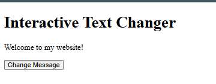
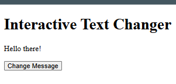
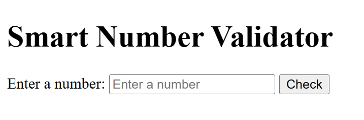
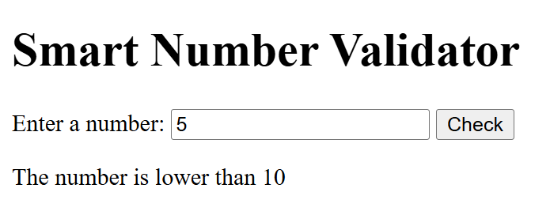
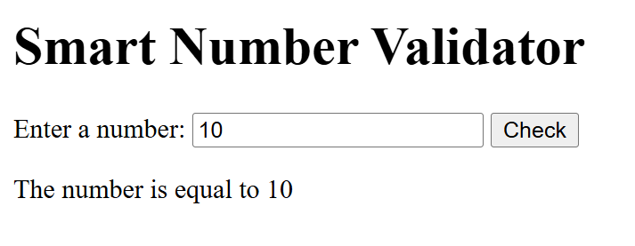
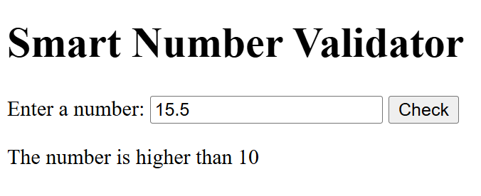
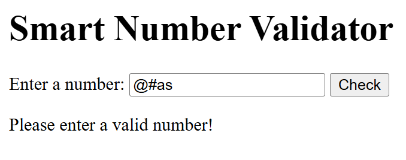
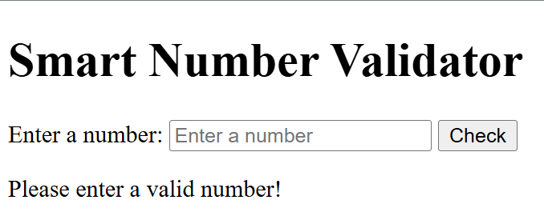
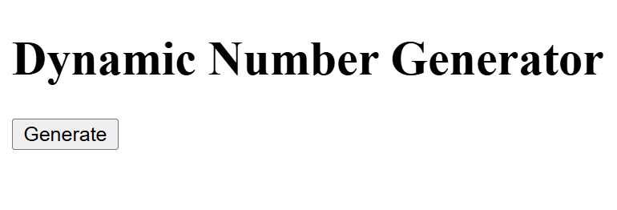
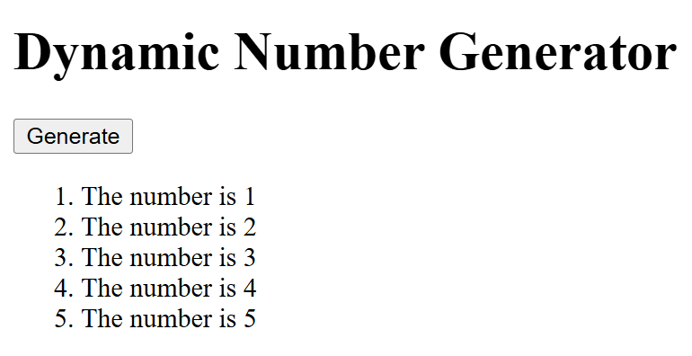

# BIC21203 Lab 4a - Client-Side Scripting (JavaScript)

**Name:** AZRAEI AZKA BIN MOHD PAIZ
**Student ID:** AI240058

## Description

This lab contains three small web pages built with HTML and JavaScript. They demonstrate functions, event listeners, input validation, loops, and DOM manipulation.

- **Q1 - Interactive Text Changer:** Changes a paragraph when a button is clicked.
- **Q2 - Smart Number Validator:** Checks a number entered by the user and shows whether it is lower than, higher than, or equal to 10. Empty and non-numeric input is rejected.
- **Q3 - Dynamic Number Generator:** Generates an ordered list from 1 to 5 using a `for` loop, without duplicates on repeated clicks.

## How to Run

No installation is needed. Download the repository and open the `index.html` file of each question in a web browser.

- **Q1:** Open `Q1/index.html` and click "Change Message".
- **Q2:** Open `Q2/index.html`, enter a value, and click "Check".
- **Q3:** Open `Q3/index.html` and click "Generate".

## Screenshots

## Screenshots

### Q1 - Interactive Text Changer

Before click:

After click:

### Q2 - Smart Number Validator

Before input:

Input lower than 10:

Input equal to 10:

Input higher than 10:

Invalid input:

Empty input:

### Q3 - Dynamic Number Generator

Before click:

After click:

